# nieves_2048

## RONDA 1 — Compactar una fila (quitar los huecos)
### ROJO
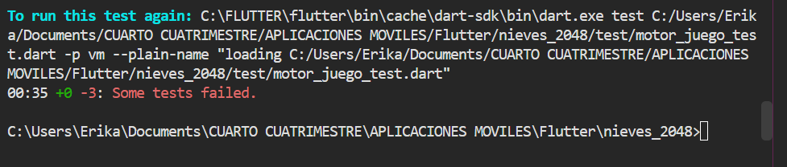

### VERDE
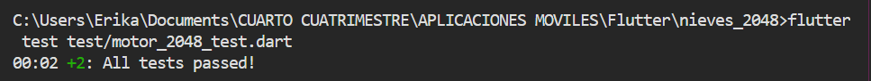

## RONDA 2 — Fusionar pares adyacentes iguales
### ROJO
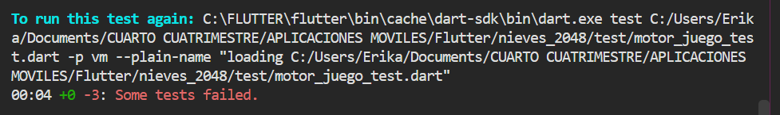

### VERDE
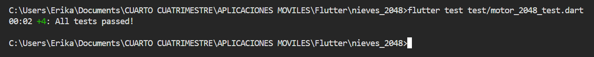

## RONDA 3 — Mover una fila completa hacia la izquierda
### ROJO
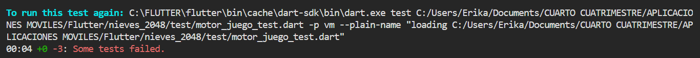

### VERDE
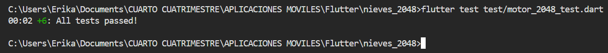

## RONDA 4 — Mover la cuadrícula completa hacia la izquierda
### ROJO
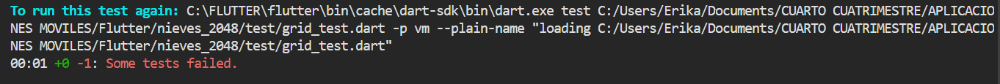

### VERDE
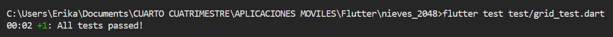

## RONDA 5 — Mover hacia la derecha (reutilizando la lógica base)
### ROJO
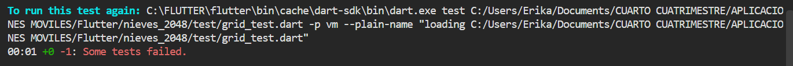

### VERDE
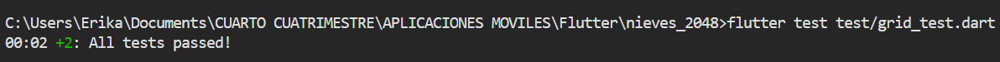

## RONDA 6 — Mover arriba y abajo (transponer la cuadrícula)
### ROJO
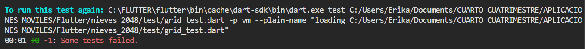

### VERDE
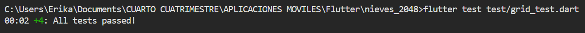

## RONDA 7 — Agregar una ficha nueva al azar
### ROJO
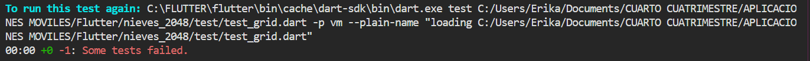

### VERDE
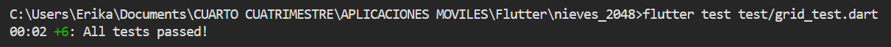

## RONDA 8 — Detectar si ya no hay movimientos posibles
### ROJO
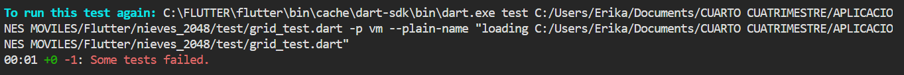

### VERDE
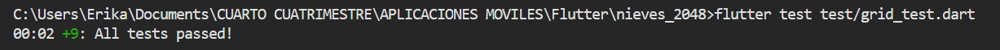

## RONDA 9 — Detectar la victoria
### ROJO
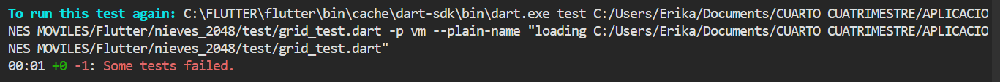

### VERDE
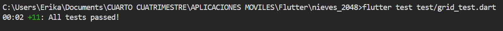

## RONDA 10 — MotorJuego: integrar todo (puntaje, turnos, victoria/derrota)
### ROJO
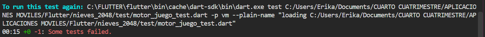

### VERDE
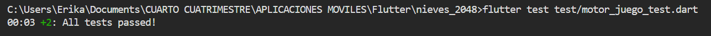

## Prueba de integración: una partida completa
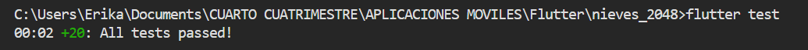